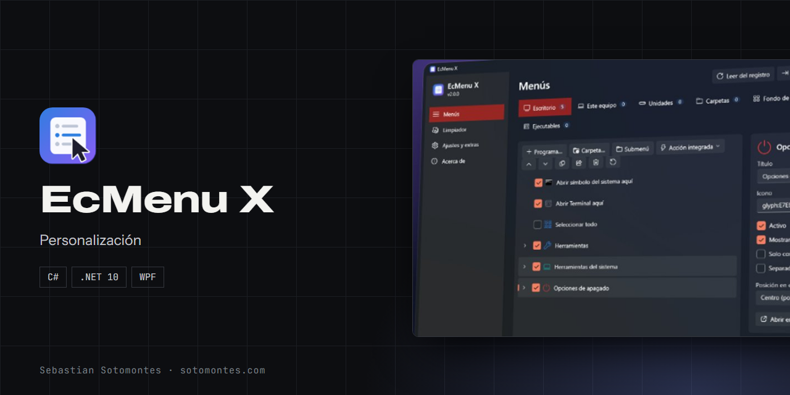
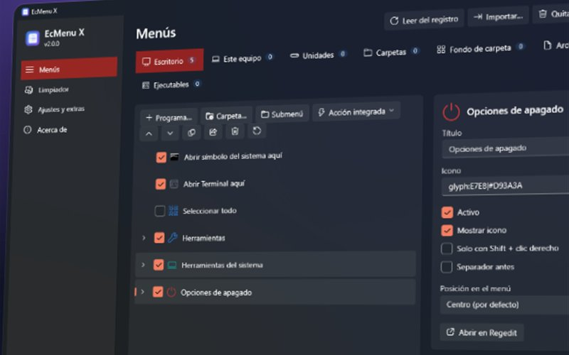
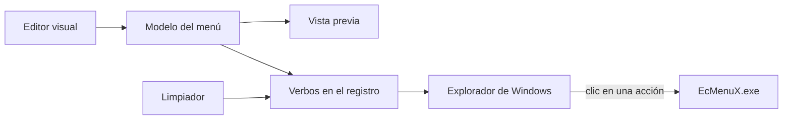

<p align="center"></p>

<p align="center">Personaliza el clic derecho de Windows con más de 50 acciones, submenús y un limpiador, sin permisos de administrador.</p>

<p align="center"><a href="https://sotomontes.com/#ecmenu-x"><b>Ver en sotomontes.com</b></a> · <a href="#cómo-se-usa">Cómo se usa</a> · <a href="#cómo-funciona-por-dentro">Cómo funciona</a> · <a href="#novedades">Novedades</a></p>

| Ficha técnica | |
|---|---|
| **Autor** | Sebastian Sotomontes |
| **Tipo** | Personalización |
| **Plataforma** | Windows 10 y 11 |
| **Versión** | 2.0.0 |
| **Estado** | Estable |
| **Stack** | C# · .NET 10 · WPF |
| **Código** | Privado. Esta página es solo una presentación. |

---

## Qué es

EcMenu X convierte en algo visual la personalización del clic derecho de Windows. Normalmente hay que editar el registro a mano; aquí eliges lo que quieres, ves cómo quedará y lo aplicas con un clic, sin permisos de administrador.

<p align="center"></p>

## Novedades

- Versión 2.0 con interfaz Fluent, limpiador y más de 50 acciones.

## Cómo se usa

1. Abre EcMenu X y elige una ubicación: Escritorio, Este equipo, Unidades, Carpetas, Fondo de carpeta, Archivos o Ejecutables.
2. Marca las acciones integradas que quieras o arrastra un programa, carpeta o script a la lista.
3. Organiza con submenús, separadores y posición. Mira la vista previa para ver cómo quedará.
4. Pulsa **Aplicar cambios**.
5. Abre **Limpiador** para desactivar entradas de otros programas que te sobran.
6. En **Ajustes y extras** elige el tema y, en Windows 11, recupera el menú clásico completo.

## Funciones

- **7 ubicaciones**: escritorio, unidades, carpetas, archivos y más.
- **Editor visual** con submenús, orden y separadores.
- **Vista previa en vivo** antes de aplicar los cambios.
- **Más de 50 acciones** listas para usar.
- **Limpiador** de entradas, reversible y con copia de seguridad.
- **Sin administrador** por defecto, con tema claro y oscuro.

## Detalles

- Acciones como abrir Terminal aquí, tomar posesión, bloquear en el firewall, calcular hash, copiar ruta y opciones de apagado.
- Desactivar en el limpiador es reversible y eliminar guarda antes una copia.
- Exporta tu configuración e impórtala en otro equipo.
- Modo portable.
- En español e inglés.
- Acciones disponibles también por línea de comandos.

## Cómo funciona por dentro

### Flujo



### 🔬 Cómo funciona

EcMenu X no instala extensiones shell ni DLLs: escribe verbos estáticos en el registro, que el Explorador lee directamente.

```text
HKCU\Software\Classes\<ubicación>\shell\EcX.NN.<id>
    MUIVerb      = "Abrir Terminal aquí"
    Icon         = …\EcMenuX\Icons\E756_6B7280.ico     (glifo Fluent → .ico generado)
    Position     = Top | Bottom                          (opcional)
    Extended     = ""                                    (solo con Shift)
    HasLUAShield = ""                                    (escudo de administrador)
    SubCommands  = ""  + subclave shell\NN.<id>          (submenús)
    command\(Default) = "%LOCALAPPDATA%\Programs\EcMenuX\EcMenuX.exe" /CopyPath "%1"
```

Cada clave lleva el valor `EcMenuX`, así que «Quitar todo» nunca toca entradas ajenas.

---

<sub>© 2026 Sebastian Sotomontes. Todos los derechos reservados.</sub>
